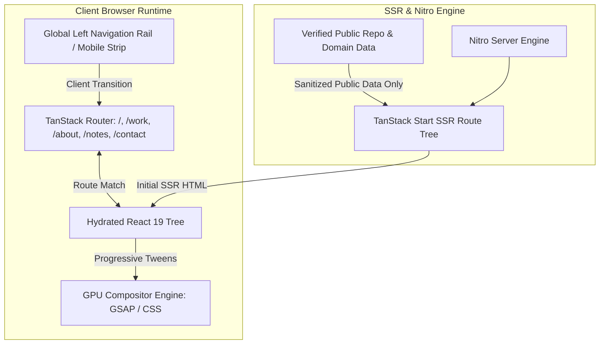

# System Architecture & Technical Specifications

**Subject**: Five-Route Architecture, Routing, Page-Local Boundaries, and Layout Contracts  
**Status**: ACTIVE FIVE-ROUTE SPECIFICATION  
**Last Updated**: 2026-11-08  
**Repository**: `portfolio-site`

---

## 1. High-Level System Architecture & Stack Decisions

The application strictly maintains its existing foundation: **TanStack Start** with **React 19**, **Vite 8**, **Tailwind CSS v4**, and **Nitro Server Engine**.



---

## 2. Directory Topology

```
portfolio-site/
├── docs/                       # Single source of truth specifications
│   ├── PRD.md
│   ├── ARCHITECTURE.md
│   ├── DESIGN_SYSTEM.md
│   ├── CODE_STYLE.md
│   ├── DATABASE.md
│   ├── SECURITY.md
│   ├── TESTING.md
│   ├── STATE_MACHINE.md
│   ├── COMPONENT_REGISTRY.md
│   └── ANTI_SLOP.md
├── public/                     # Static public assets (favicons, robots.txt)
├── src/
│   ├── components/
│   │   ├── base/               # Accessible primitives (buttons, inputs)
│   │   ├── evil/               # Tactile buttons, CopyButton
│   │   ├── site/               # Structural chrome (NavigationDock, motion, DeterministicPixelParticles)
│   │   └── ui/                 # Installed headless UI primitives
│   ├── data/                   # Typed static data (repos.ts with all 27 verified public repos)
│   ├── routes/                 # Exactly five TanStack file-based routes
│   │   ├── __root.tsx          # Root shell layout (<Outlet />, NavigationDock, skip link)
│   │   ├── index.tsx           # / (Home): Ultra-minimal centered identity anchor
│   │   ├── work.tsx            # /work: Premotio spatial storytelling + 27-repo catalog
│   │   ├── about.tsx           # /about: Ethiack / Screenshot 1 scanner moment + factual bio
│   │   ├── notes.tsx           # /notes: Ellipsus-style authored essay on instruments
│   │   └── contact.tsx         # /contact: Screenshot 2 centered light card + direct email
│   ├── styles/                 # Theme tokens, globals, typography
│   ├── routeTree.gen.ts        # Auto-generated TanStack router tree (DO NOT EDIT MANUALLY)
│   ├── router.tsx              # Router instantiation & React Query wiring
│   ├── server.ts               # SSR entrypoint
│   ├── start.ts                # Server middleware & CSRF guards
│   └── styles.css              # Main Tailwind v4 stylesheet with @theme configuration
├── AGENTS.md                   # Runtime rules, multi-agent contracts, and code ownership
├── logger.md                   # Chronological immutable engineering ledger
├── package.json                # Project dependencies and npm scripts
├── tsconfig.json               # TypeScript strict configuration
└── vite.config.ts              # Vite 8 configuration with TanStack Start plugin
```

---

## 3. Five-Route Topology & Shared Shell Architecture

The application is structured across **exactly five distinct public routes**, each serving an explicit function with page-local design references:

1. **Home (`/`)**: Ultra-minimal centered identity anchor (italic-serif name + compact verified bio). Premotio motion is strictly excluded.
2. **Work (`/work`)**: Premotio-inspired narrative mechanism (field of artifacts $\rightarrow$ active tile untwists and docks beside repo narrative $\rightarrow$ complete 27-repo searchable index). Grounded in `contentarchitecture.dev` for IA and `datacurve.ai` for metadata specs.
3. **About (`/about`)**: Ethiack cue & Screenshot 1 scanner frame with crosshair corners housing an authored asymmetric node-and-edge network lattice (`DeterministicPixelParticles`) as the visual center, paired with compact factual bio.
4. **Notes (`/notes`)**: `ellipsus.com` literary serif typography on dark canvas, quiet margins, distraction-free reading cadence.
5. **Contact (`/contact`)**: Screenshot 2 composition: centered light/ceramic card on dark canvas, monogram fallback, verified name, and one direct email action (`ommd3076@gmail.com`).

### 3.1 Shared Shell & Navigation Rail

- **Root Shell (`__root.tsx`)**: Mounts `NavigationDock`, skip link, and `<main><Outlet /></main>`.
- **Navigation Dock (`NavigationDock.tsx`)**:
  - **Desktop**: Quiet far-left icon-only rail (`fixed left-5 top-1/2 -translate-y-1/2`), vertically centered, independent of Premotio.
  - **Mobile**: Compact bottom strip (`fixed bottom-5 left-1/2 -translate-x-1/2`), thumb-accessible (min 44px hit targets).
  - Redundant header navigation, search CTAs, and footers have been stripped to maintain clean, distraction-free focus.

---

## 4. Multi-Agent Code Ownership Contract

- **Sole Implementer**: Antigravity is the sole implementer of all application code, route wiring, styling, and documentation in this repository. Codex does not write or modify application code.
