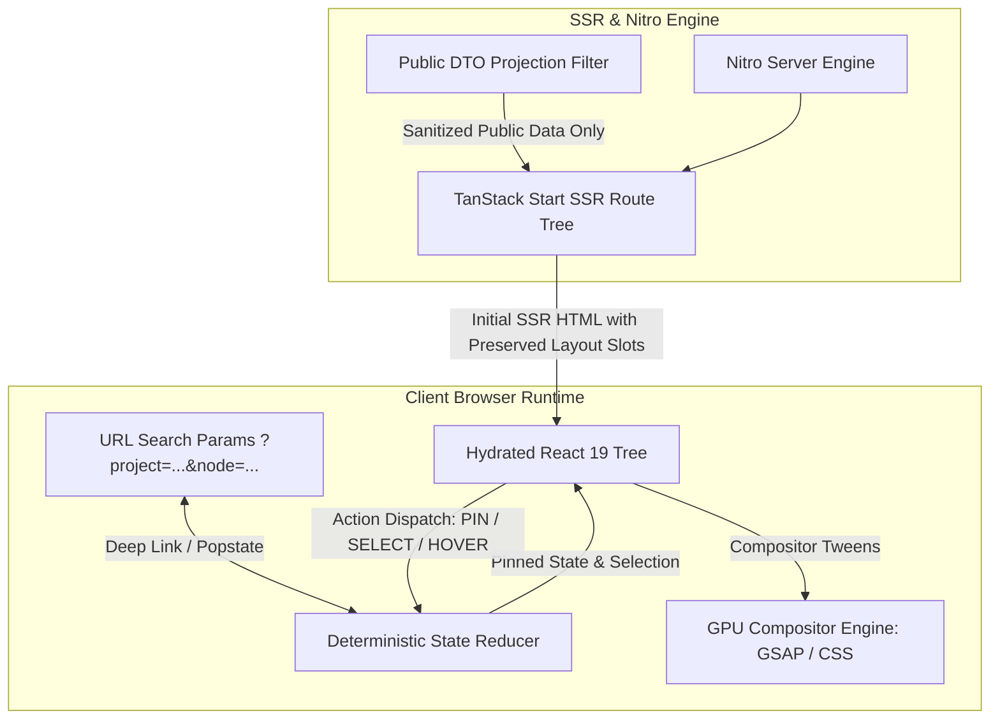

# System Architecture & Technical Specifications

**Subject**: Architecture, Routing, URL-Pinned State, and Defensive Layout Boundaries  
**Status**: DRAFT / PLANNING PHASE (Gated)  
**Last Updated**: 2026-11-08 (Post Gemini 1–4 & Grok 1–5 Consultations)  
**Repository**: `portfolio-site`

---

## 1. High-Level System Architecture & Stack Decisions

The application strictly maintains its existing foundation: **TanStack Start** with **React 19**, **Vite 8**, **Tailwind CSS v4**, and **Nitro Server Engine**.

> [!IMPORTANT]
> **Stack Preservation (Rejection of Grok 1 Deviation)**: Early advice from Grok 1 suggested replacing the stack with alternative frameworks (e.g. Astro/Next.js) and stripping interactive cross-module links. **These deviations are rejected.** The existing TanStack Start + Nitro SSR pipeline is maintained, along with the connected list/diagram/telemetry explorer architecture confirmed in Grok 2.



---

## 2. Directory Topology

```
portfolio-site/
├── .agents/                    # Agent-specific skill bindings (boardui, reui, rare-ui, ui-skills-root)
├── .mcp.json                   # Local MCP server bindings (reui, boardui, ui-skills, shadcn)
├── docs/                       # Single source of truth specifications
│   ├── PRD.md
│   ├── ARCHITECTURE.md
│   ├── DESIGN_SYSTEM.md
│   ├── CODE_STYLE.md
│   ├── DATABASE.md
│   ├── SECURITY.md
│   ├── TESTING.md
│   ├── STATE_MACHINE.md
│   ├── COMPONENT_REGISTRY.md
│   └── ANTI_SLOP.md
├── mockup/                     # Reference static HTML/CSS implementations
├── public/                     # Static public assets (favicons, robots.txt)
├── src/
│   ├── assets/                 # SVGs, verified diagrams, artwork
│   ├── components/
│   │   ├── base/               # Low-level accessible primitives (buttons, inputs)
│   │   ├── boardui/            # BoardUI status dots, banners, data primitives
│   │   ├── brand/              # Brand SVG lockups
│   │   ├── command/            # Global Command Palette (⌘K) modal
│   │   ├── editorial/          # Academic and research primitives (TOC, footnotes, citations)
│   │   ├── evil/               # Tactile buttons, magnetic links, copy interactions
│   │   ├── glass/              # High-contrast glass panels and editorial surfaces
│   │   ├── rare/               # Subtle tickers and marquees via GSAP
│   │   ├── site/               # Structural chrome (HeaderBar, Chrome, ProjectExplorer, motion)
│   │   ├── ui/                 # Installed headless UI primitives (Radix, React Aria)
│   │   └── visualizers/        # Unmounted candidate visualizers (retained in library)
│   ├── data/                   # Typed static data & factual schemas
│   ├── hooks/                  # Custom React hooks (usePrefersReducedMotion, useURLState)
│   ├── lib/                    # Core utilities & helpers (cx, utils)
│   ├── routes/                 # TanStack file-based routing
│   │   ├── __root.tsx          # Root shell layout (<Outlet />, scroll restoration, ⌘K)
│   │   ├── index.tsx           # Quiet editorial visual anchor (image-1.png match, 540px column)
│   │   ├── work.tsx            # First-viewport interactive topology workspace & workReducer
│   │   ├── about.tsx           # Engineering background, founder journey, IEEE citation
│   │   ├── approach.tsx        # First-principles methodology & 4 hypothesis stages
│   │   ├── future.tsx          # Architectural theses & conceptual foundations
│   │   └── contact.tsx         # Quiet, functional contact channels
│   ├── styles/                 # Theme tokens, globals, typography
│   │   ├── globals.css
│   │   ├── theme.css
│   │   └── typography.css
│   ├── routeTree.gen.ts        # Auto-generated TanStack router tree (DO NOT EDIT MANUALLY)
│   ├── router.tsx              # Router instantiation & React Query wiring
│   ├── server.ts               # SSR entrypoint & CSP headers
│   ├── start.ts                # Server middleware & CSRF guards
│   └── styles.css              # Main Tailwind v4 stylesheet with @theme configuration
├── AGENTS.md                   # Runtime rules, Lovable bindings, and agent contracts
├── logger.md                   # Chronological immutable engineering ledger
├── package.json                # Project dependencies and npm scripts
├── tsconfig.json               # TypeScript strict configuration
└── vite.config.ts              # Vite 8 configuration with TanStack Start plugin
```

---

## 3. URL-Pinned State Architecture (Gemini 1 & 2 Synthesis)

The primary interactive state machine resides on the Work route (`/work`), linking URL search parameters with a centralized deterministic reducer (`workReducer`):

1. **URL as Ground Truth for Pinned Elements**:
   - The query string (`/work?project=<slug>&category=<cat>&node=<nodeId>`) represents the canonical selection.
   - Deep linking is supported: visitors landing with query params immediately hydrate into the pinned view.
   - Browser back/forward navigation (`popstate`) restores pinned state predictably without page reloads.
   - Home (`/`) is strictly a quiet editorial anchor with zero URL search parameters or interactive reducer state.
2. **Transient vs. Pinned State**:
   - `hoveredId` is strictly transient, unpinned, and debounced (40ms). It does **not** update URL parameters.
   - `focusedId` / `pinnedId` requires an explicit user action (click or keyboard Enter/Space), updating the URL and pinning the connected modules.
   - Pinned state has strict priority over transient hover state.

---

## 4. Defensive Layout Bounding & Motion Isolation

### 4.1 First-Viewport Interactive Topology on `/work`

To eliminate vertical gaps and ensure immediate interactive affordance upon landing on `/work`:
- **Viewport Coordinates**: Interactive workspace (`#work-workspace`) starts at $Y = 250\text{px}$ and terminates at $Y = 680\text{px}$ (total height $429\text{px}$), fitting completely within the standard $1280 \times 800$ first viewport (`FitsFirstViewport = true`).
- **Header Geometry**: Compact vertical rhythm (`pt-16 md:pt-20 pb-12`) with an inline category `FilterGroup` placed directly adjacent to the section title.
- **Defensive Sizing**: Asymmetric CSS Grid layout (`1fr + 260px` or full width on mobile) reserving explicit layout bounds to prevent Cumulative Layout Shift (CLS = 0.00).
- **Text Stability**: No aggressive `overflow: hidden` on text containers; dynamic text scales cleanly up to 200% browser zoom without truncation.

### 4.2 Motion Rules & Animation Engine Arbitration (Gemini 5 Conflict Prevention)

> [!NOTE]
> **Attribution Correction**: Gemini 5 did **not** recommend introducing Framer Motion (which was pre-installed in `package.json` ^12.43.0). Gemini 5's advice strictly addressed **preventing conflicting writes** between animation engines. The primary motion engine remains GSAP for timelines and SVG transforms, with CSS transitions for micro-interactions.

1. **Compositor-Only Animations**: Only animate `transform`, `opacity`, and GPU-composited SVG properties. Avoid animating layout-triggering properties (`width`, `height`, `margin`, `top`, `left`).
2. **Prevent Conflicting Writes**: Never attach both a GSAP tween and a CSS transition or other animation runner to the exact same DOM property on a single node.
   - **GSAP**: Primary authority for multi-step timelines, load sequences, and SVG coordinate transformations.
   - **CSS Transitions**: Primary authority for low-overhead interactive micro-interactions (hover, focus color shift, button active states).
3. **Pure Factual SVGs**: All architectural diagrams (e.g. PRISM system shape) must be authored as factual SVGs matching typed graph contracts, with real text nodes rather than outlined path vectors.
4. **Lifecycle & Interruption Safety via `@gsap/react` (`useGSAP`, `contextSafe`)**:
   - All component animations use `@gsap/react` with `useGSAP` and `contextSafe` for SSR safety and scoped context cleanup.
   - Configured with `revertOnUpdate: false` to guarantee reversion occurs **strictly on component teardown (unmount)**, preventing mid-selection snaps.
   - For rapid retargeting (60ms stress cycling), active tweens are killed (`gsap.killTweensOf`) while **preserving current inline transforms**, animating smoothly to the new target.
5. **Select-Only SVG Tether Specification**:
   - Presentation-only curve linking active listbox selection to detail nodes.
   - Hidden at mobile widths (<768px).
   - Hidden immediately during active page scroll (`opacity: 0`), debounced at 120ms to re-measure and smoothly fade back in (`opacity: 0.45`) upon settling.
6. **Reduced-Motion Fallback**: When `prefers-reduced-motion: reduce` is detected, animations bypass timeline execution and resolve immediately to final rest states.

---

## 5. Performance Targets & Budgets

| Metric                              | Target Budget       | Enforcement Mechanism                                                   |
| ----------------------------------- | ------------------- | ----------------------------------------------------------------------- |
| **First Contentful Paint (FCP)**    | `< 0.9s`            | Pure semantic SSR HTML output via Nitro                                 |
| **Largest Contentful Paint (LCP)**  | `< 1.4s`            | Prioritize text content over heavy imagery; lazy-load secondary visuals |
| **Cumulative Layout Shift (CLS)**   | `< 0.05`            | Defensive CSS Grid and container size reservations                      |
| **Interaction to Next Paint (INP)** | `< 50ms`            | Zero synchronous heavy computation on main thread                       |
| **Frame Stability**                 | Smooth 60fps/120fps | Compositor-driven transforms, zero layout thrashing                     |

---

## 6. Zero Band-Aid Engineering Guardrails

1. **No Stacking Hacks**: Never use `!important`, arbitrary `z-[9999]`, or indiscriminate `overflow-hidden` to mask layout collisions.
2. **Preserve Readable Content**: Never allow motion or decorative frames to clip or hide primary readable text.
