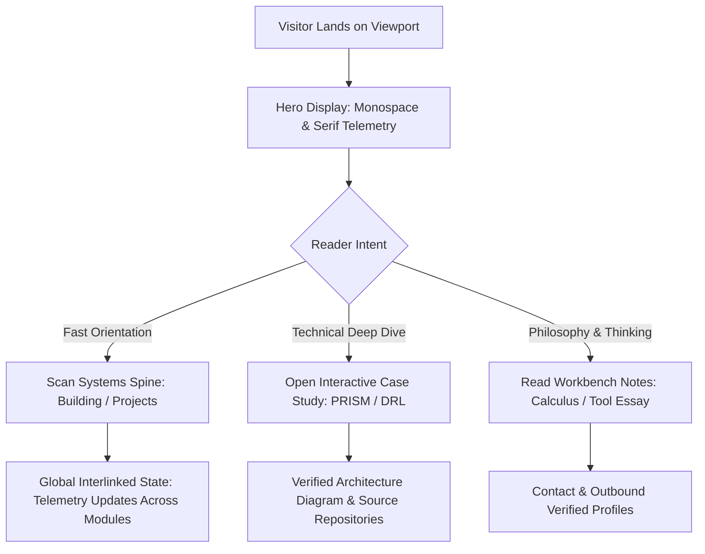

# Product Requirements Document (PRD) — Personal Portfolio

**Subject**: Om M. Doddamani  
**Status**: DRAFT / PLANNING PHASE (Gated)  
**Last Updated**: 2026-11-08  
**Repository**: `portfolio-site` (`https://github.com/ommd3076/Website-protfolio.git`)

---

## 1. Executive Summary & Objective

The objective of this project is to build an elite, authentic, and technically credible personal engineering portfolio for **Om M. Doddamani**.

The portfolio is designed to leave a thoughtful, lasting impression of an engineer with deep technical intuition, rapid adaptability across unfamiliar stacks, and sound architectural judgment earned through direct cycles of making, breaking, and revising real systems.

It is **not** a generic marketing landing page, an agency showcase, or an AI-slop template. It is an editorial, systems-focused instrument reflecting quiet luxury, technical rigor, and honest engineering evidence.

---

## 2. Target Audience & Reader Goals

1. **Senior Technical Founders & Engineering Leaders**: Seeking evidence of real implementation ability, systems-level thinking, architectural maturity, and rapid orientation in complex problems.
2. **Investors**: Looking for authentic founder drive, intellectual depth, technical adaptability, clarity of thought, and disciplined execution.
3. **Potential Co-Founders & Technical Peers**: Looking for a high-signal collaborator with strong research and systems intuition.

---

## 3. Approved Biographical Baseline & Source Evidence

Every factual claim on the site must be grounded in verified primary evidence. Unsubstantiated claims, invented metrics, or exaggerated titles are strictly prohibited.

### 3.1 Personal Baseline (Verified from Screenshot & Brief)

- **Full Name**: Om M. Doddamani (`Om M Doddamani`)
- **Education**: Third-year Computer Science and Engineering student at Vidyavardhaka College of Engineering, Mysuru.
- **Role**: Founder at Cerenetics (startup focused on intelligent, practical software solutions for real-world problems).
- **Core Focus**: Intersection of Artificial Intelligence, software engineering, entrepreneurship, and emerging technologies.
- **Key Technical Interests**: Hybrid AI architectures, quantum machine learning, optimization, and intelligent software systems.
- **Approved Profiles**:
  - GitHub: `https://github.com/ommd3076`
  - LinkedIn: `https://www.linkedin.com/in/om-m-doddamani/`

### 3.2 Key Public Narratives & Tone

- **Core Engineering Strength**: Technical intuition, fast orientation in unfamiliar domains, adaptability, and practical judgment (choosing the next useful step). Avoid hype phrases like "grasping power" or "visionary genius".
- **The Cycle of Building**: Openly acknowledge the reality of trying, failing, learning, and taking responsibility for decisions.
- **The Instrument / Tool Narrative (Newton & Leibniz)**:
  - Historical context: Newton’s questions about motion drove his development of fluxions as calculus emerged, while Leibniz independently developed calculus and introduced the notation widely used today.
  - Extrapolation: Better instruments expand human capability—a more precise tool gives a surgeon greater control; sharper research instruments make previously intractable questions solvable. One advance makes room for the next.
  - Stated as the author’s philosophical perspective on engineering, not a dogmatic or neuroscientific claim.

### 3.3 Candidate Projects & Evidence Status

1. **PRISM (Research · Offline AI)**:
   - _Status_: Accepted for conference presentation.
   - _Evidence Required_: Paper citation, formal venue name, dates, author order, and verified role description before full case study publication.
2. **Deep Reinforcement Learning (Research · Game Systems)**:
   - _Status_: Presented at IEEE AIEI.
   - _Evidence Required_: Verification of conference proceedings, paper title, implementation repository, and exact experimental scope.
3. **Cerenetics (Company · Applied AI)**:
   - _Status_: Founder work in progress.
   - _Evidence Required_: Clear distinction between personal engineering contribution and broader company team output.
4. **EVA (First Hackathon Attempt · Office Automation)**:
   - _Status_: Learning attempt (did not work as intended).
   - _Framing_: Honest reflection on scope, mismatched assumptions, and engineering lessons.

---

## 4. User Journeys

---

## 5. Core Architectural & Visual Requirements

1. **Aesthetic Direction**: "Credible Engineering" — inspired by Paco Coursey (`paco.me`), Rauno Freiberg, Linear, and Lee Robinson. Narrow, restrained column, small typography (13px–15px body), high density, generous white space, and zero visual clutter.
2. **Hero Presentation**: Compact focal display incorporating **Instrument Serif** ("Intel Serif") italic display contrast alongside crisp sans-serif and monospace telemetry, matching the provided screenshot reference (`image-1.png`).
3. **Global Interlinked Modules**: Animations must not be confined to isolated hover cards. User interaction on one module must propagate state and telemetry across connected sections via a deterministic state machine.
4. **Progressive Enhancement**: Content must render legibly if JavaScript fails or animations are disabled.
5. **Reduced Motion**: Full compliance with `prefers-reduced-motion: reduce`. Zero animations, zero layout transitions, immediate visibility.

---

## 6. Strict Non-Goals & Anti-Features

- **NO Marketing Fluff / AI Hype**: No glowing neon cards, generic gradient blobs, particle swarms, or buzzwords ("revolutionizing", "supercharging").
- **NO Invented Metrics**: No fake testimonials, fabricated benchmarks, or inflated visitor counts.
- **NO Unvetted Dependencies**: No heavy 3D canvases or animation libraries that thrash CPU/GPU or degrade frame rates below 60fps.
- **NO Broken Application Slices**: No commit or release before explicit planning gates and adversarial verification pass.
