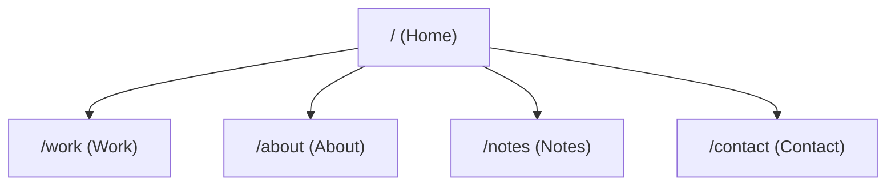

# Product Requirements Document (PRD) — Personal Portfolio

**Subject**: Om M. Doddamani  
**Status**: ACTIVE FIVE-ROUTE SPECIFICATION  
**Last Updated**: 2026-11-08  
**Repository**: `portfolio-site` (`https://github.com/ommd3076/Website-protfolio.git`)

---

## 1. Executive Summary & Objective

The objective of this project is to build an elite, authentic, and technically credible personal engineering portfolio for **Om M. Doddamani**.

The portfolio is designed to leave a thoughtful, lasting impression of an engineer with deep technical intuition, rapid adaptability across unfamiliar stacks, and sound architectural judgment earned through direct cycles of making, breaking, and revising real systems.

It is **not** a generic marketing landing page, an agency showcase, or an AI-slop template. It is an editorial, systems-focused instrument reflecting quiet luxury, technical rigor, and honest engineering evidence.

---

## 2. Five-Route Topology & Page-Local Reference Boundaries

The portfolio is strictly structured across **exactly five distinct public routes**:

| Route                    | Purpose                                                                                                                      | Allowed Reference(s)                                                                                                                                                                                  | Concrete Borrowed Pattern                                                                                                                                                                                                                                                                                                                            | Explicitly Excluded                                                                                                                                                                                                                  |
| :----------------------- | :--------------------------------------------------------------------------------------------------------------------------- | :---------------------------------------------------------------------------------------------------------------------------------------------------------------------------------------------------- | :--------------------------------------------------------------------------------------------------------------------------------------------------------------------------------------------------------------------------------------------------------------------------------------------------------------------------------------------------- | :----------------------------------------------------------------------------------------------------------------------------------------------------------------------------------------------------------------------------------- |
| **`/` (Home)**           | Quiet, minimal identity entrypoint establishing focus, domain, and calm navigation.                                          | **Independent** (Self-contained design)                                                                                                                                                               | Minimalist centered typographic hierarchy (italic-serif name + compact verified bio), calm navigation via global far-left rail / bottom strip.                                                                                                                                                                                                       | • Premotio motion/transitions. • Pulsing live dots or "Available for dialogue" badges. • Synthetic telemetry, metrics, or marketing slogans. • Wide marketing hero or CTA button rows.                                      |
| **`/work` (Work)**       | Comprehensive technical output showcase covering verified domains, project staging, and the complete 27-repo public catalog. | • **`contentarchitecture.dev`** (IA & taxonomy) • **`Premotio`** (Spatial transitions & project staging exclusively on `/work`) • **`datacurve.ai`** (Technical typography & spec presentation) | • Disciplined domain categorization & filtering (`contentarchitecture.dev`). • Premotio narrative mechanism: field of artifacts $\rightarrow$ active tile untwists and docks beside repo narrative $\rightarrow$ complete 27-repo searchable index (`Premotio`). • Monospaced technical metadata tags and specification rows (`datacurve.ai`). | • Premotio bleed to any other route. • Any private repository names (strictly 27 public repos). • Unsubstantiated claims ("without cloud dependence", "PRISM" codename). • Unmotivated scroll-jacking or heavy 3D canvases. |
| **`/about` (About)**     | Factual background and academic foundation.                                                                                  | • **Screenshot 1** (`image-1.png`) • **Ethiack cue**                                                                                                                                               | • Bounded dark scanner frame with crosshair corners housing an authored asymmetric node-and-edge network lattice (`DeterministicPixelParticles`) as the visual center, paired with a compact factual bio.                                                                                                                                            | • Premotio motion. • Inflated founder puffery or unverified biographical claims. • Unverified CGPA metrics or generic principle card stacks.                                                                                   |
| **`/notes` (Notes)**     | Dedicated reading space for long-form technical essays and reflections (instruments and capability).                         | • **`ellipsus.com`** exclusively                                                                                                                                                                      | • Warm literary editorial serif typography on a dark canvas, wide line height, restrained margins, distraction-free reading cadence.                                                                                                                                                                                                                 | • Premotio spatial transitions. • Placeholder/synthetic articles. • Social widgets, claps, or engagement metrics.                                                                                                              |
| **`/contact` (Contact)** | Frictionless direct communication channels and verified public identity.                                                     | • **Screenshot 2** (`image-2.png`) composition exclusively                                                                                                                                            | • Centered light/ceramic card on dark canvas, restrained monogram fallback portrait slot, verified name, and one direct email action (`ommd3076@gmail.com`) with copy button.                                                                                                                                                                        | • Premotio motion. • Pulsing status dots or simulated availability indicators. • Unconnected backend contact form fields.                                                                                                      |

---

## 3. Approved Biographical Baseline & Source Evidence

Every factual claim on the site is grounded in verified primary evidence:

- **Full Name**: Om M. Doddamani (`Om M Doddamani`)
- **Education**: Third-year Computer Science and Engineering student at Vidyavardhaka College of Engineering (VVCE), Mysuru.
- **Role**: Founder at Cerenetics (startup focused on intelligent, practical software solutions for real-world problems).
- **Verified Public Repositories**: Exactly 27 public repositories on GitHub (`@ommd3076`), all indexed on `/work`.
- **Approved Outbound Profile**: GitHub: `https://github.com/ommd3076`
- **Primary Direct Channel**: `ommd3076@gmail.com`

---

## 4. Multi-Agent Code Ownership Contract

- **Sole Implementer**: Antigravity is the sole implementer of application code, route wiring, styling, and documentation. Codex does not write or modify application code.
