# Global Interlinked State Machine & Decision Trees

**Subject**: State Machine Architecture, URL-Pinned State, Hover/Focus Precedence, and Accessible Listbox Contracts  
**Status**: DRAFT / PLANNING PHASE (Gated)  
**Last Updated**: 2026-11-08 (Post Gemini 1–4 & Grok 1–5 Consultations)  
**Repository**: `portfolio-site`

---

## 1. Architectural Philosophy: The Connected Explorer

The portfolio operates as a unified systems-engineering instrument:

- A user interacting with the **Project List** simultaneously coordinates the **System Diagram**, the **Telemetry Monitor**, and the **Context Panel**.
- State is deterministic, backed by a central reducer, synchronized with URL search params for deep linking, and strictly separates transient hover previews from pinned selections.

```mermaid
stateDiagram-v2
    [*] --> Idle

    Idle --> HoverPreview: HOVER_ITEM (debounced 40ms)
    HoverPreview --> Idle: LEAVE_ITEM

    Idle --> Pinned: PIN_SELECTION (click / Enter)
    HoverPreview --> Pinned: PIN_SELECTION (click / Enter)

    state Pinned {
        [*] --> ProjectPinned
        ProjectPinned --> NodePinned: PIN_NODE (nodeId)
        NodePinned --> ProjectPinned: UNPIN_NODE
    }

    Pinned --> Pinned: HOVER_OTHER (cosmetic hint only; does NOT overwrite pinned display)
    Pinned --> Idle: UNPIN_ALL (Escape / click-outside)
    Pinned --> Pinned: PIN_NEW_PROJECT (explicit selection)
```



---

## 2. Global State Store Specification

Driven by a centralized reducer, synchronized with URL search parameters (`?project=<slug>&node=<nodeId>`):

```typescript
export interface GlobalPortfolioState {
  // Pinned State (Canonical / URL-Synchronized)
  pinnedProjectId: string | null;
  pinnedNodeId: string | null;

  // Transient Hover State (Local, Debounced, Secondary Precedence)
  hoveredProjectId: string | null;
  hoveredNodeId: string | null;

  // Telemetry Metrics (Derived / Live)
  telemetry: {
    activeNodesCount: number;
    streamHealth: "nominal" | "calibrating" | "focused";
    computeMode: string;
  };

  // Accessibility & Preferences
  prefersReducedMotion: boolean;
  activeDescendantId: string | null;
}

export type PortfolioAction =
  | { type: "PIN_PROJECT"; projectId: string; updateUrl?: boolean }
  | { type: "UNPIN_PROJECT" }
  | { type: "PIN_NODE"; nodeId: string; updateUrl?: boolean }
  | { type: "UNPIN_NODE" }
  | { type: "HOVER_PROJECT"; projectId: string }
  | { type: "LEAVE_PROJECT" }
  | { type: "HOVER_NODE"; nodeId: string }
  | { type: "LEAVE_NODE" }
  | { type: "SYNC_FROM_URL"; queryParams: { project?: string; node?: string } }
  | { type: "SET_REDUCED_MOTION"; enabled: boolean };
```

---

## 3. Precedence Rules & Conflict Resolution (Gemini 2 Synthesis)

To eliminate erratic UI jumping during interaction, the reducer enforces strict precedence:

1. **Pinned Selection Strictly Overrides Hover**:
   - When `pinnedProjectId` is active, hovering over another project card does **not** replace the active diagram, telemetry, or details view.
   - The hovered item receives a subtle, local border/cursor highlight only (cosmetic feedback), but the system view remains locked to the pinned project.
2. **Explicit Pinning**:
   - Pinning requires an explicit user intent: mouse click or keyboard activation (`Enter` / `Space`).
3. **Explicit Unpinning**:
   - Pressing `Escape`, clicking a clear button, or clicking outside the explorer unpins the current selection and returns to `Idle`.
4. **URL Synchronization & Validation**:
   - When a project or node is pinned, the router replaces or pushes the search params: `?project=prism&node=input`.
   - On page load or `popstate` (browser Back/Forward), incoming query parameters are validated against known project slugs and node IDs via Zod. Invalid or unapproved slugs fall back safely to `null` (Idle).

---

## 4. Accessible Single-Select Listbox Pattern (Grok 4 Correction)

> [!IMPORTANT]
> **Accessibility Architecture (Rejection of Invalid ARIA)**:
> Grok 4 identified critical ARIA violations common in AI-generated code: putting `aria-selected` on non-option elements (like generic buttons or divs) and nesting interactive `<a href="...">` links inside listbox options.

The Explorer component implements the official **WAI-ARIA Single-Select Listbox** pattern:

1. **Container Semantics**:
   - The list container has `role="listbox"`, `aria-label="Selected Engineering Work"`, and `aria-activedescendant="option-<id>"`.
   - Keyboard navigation supports `ArrowUp` / `ArrowDown` for moving active descendant, `Home` / `End`, `Enter` / `Space` to pin, and `Escape` to unpin.
2. **Item Semantics**:
   - Each project item has `role="option"`, `id="option-<slug>"`, and `aria-selected="true|false"` (reflecting whether it is pinned).
3. **External Link Decoupling (Strict Rule)**:
   - **Zero Nested Links in Options**: Never place `<a href="...">` (such as GitHub or paper links) inside the `role="option"` elements.
   - External action links belong strictly in the **Context / Details Panel** outside the listbox, accessible via standard Tab focus order.

---

## 5. Cross-Module Reaction Matrix

| Trigger                                        | Initiating Module | Diagram Display                 | Telemetry Readout                   | Context / Detail Panel                                     |
| ---------------------------------------------- | ----------------- | ------------------------------- | ----------------------------------- | ---------------------------------------------------------- |
| `HOVER_PROJECT(prism)` _(when unpinned)_       | Project Listbox   | Previews PRISM 4-node pipeline  | Displays "Offline AI / Local 4-bit" | Previews problem statement                                 |
| `PIN_PROJECT(prism)`                           | Project Listbox   | Locks PRISM pipeline in view    | Locks telemetry metrics stream      | Focuses full verified case study                           |
| `HOVER_PROJECT(drl)` _(while PRISM is pinned)_ | Project Listbox   | **Remains PRISM** (no jump)     | **Remains PRISM**                   | **Remains PRISM** (hovered row shows local highlight only) |
| `PIN_NODE(input)`                              | System Diagram    | Highlights input ingestion node | Displays node tensor shapes         | Displays input schema specification                        |
| `UNPIN_ALL` (Escape)                           | Keyboard / Shell  | Returns to baseline overview    | Returns to ambient idle state       | Returns to default workbench notes                         |

---

## 6. Synchronous Accessible State Commit & Interruption Safety (Gemini 6 Synthesis)

### 6.1 Authoritative React State & Immediate Accessible Mounting

- **Rejection of Delayed Midpoint Content**:
  - The authoritative React state (`pinnedProjectId`, `selectedNodeId`) updates synchronously upon selection.
  - Accessible text and ARIA properties (`aria-selected="true"`, `aria-activedescendant`) mount in the DOM immediately on the same render tick.
  - Motion is purely presentational: GSAP tweens visual properties (`opacity`, `transform`, `clipPath`), guaranteeing that screen readers and automated test harnesses perceive state updates without waiting for motion completion.

### 6.2 Interruption-Safe & Kill-Safe Timelines

- When a user rapidly cycles through selections (via keyboard arrow keys, rapid clicks, or scrubbed touch events), lingering animations from previous transitions must not queue or corrupt the display.
- Every state transition executes an explicit kill routine:
  ```typescript
  gsap.killTweensOf([diagramRef.current, detailRef.current, tetherRef.current]);
  ```
  This immediately halts active tweens, clears transform caches, and executes the new transition from the current visual position.

### 6.3 Focus Retention & Keyboard Navigation

- When navigating the listbox via `ArrowUp` / `ArrowDown`, focus remains on the listbox container while `aria-activedescendant` updates to the current option's ID.
- Activating `Enter` or `Space` pins the project and transfers focus logically to the Context/Detail panel action bar or preserves position for subsequent `Tab` navigation.
- Activating `Escape` unpins the project and restores focus to the previously active listbox item.

### 6.4 Touch Handling & URL Navigation Synchronization

- **Touch Devices**:
  - Touch taps act as explicit select/pin actions; hover preview logic is bypassed on touch-primary viewports (`pointer: coarse`).
- **URL Search Params Synchronization**:
  - Pinned states sync to URL query parameters (`?project=prism&node=input`).
  - During rapid cycling, query updates use `replace: true` to avoid cluttering the browser history stack.
  - Direct deep linking and browser Back/Forward (`popstate`) events hydrate the state machine deterministically through Zod schema validation.
