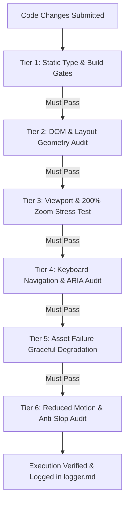

# Testing & Adversarial Verification Matrix

**Subject**: Adversarial Testing, Viewport Zoom, Keyboard Accessibility, Asset Degradation, and Zero False Positives  
**Status**: DRAFT / PLANNING PHASE (Gated)  
**Last Updated**: 2026-11-08 (Post Gemini 1–4 & Grok 1–5 Consultations)  
**Repository**: `portfolio-site`

---

## 1. Adversarial Verification Philosophy (Zero Confirmation Bias)

In motion-heavy and interaction-rich web engineering, **passing `tsc` or `npm run build` is a necessary baseline, but it does NOT prove the interface works**.

Amateur AI workflows suffer from confirmation bias: assuming that because no terminal error was thrown, an animation looks right or a layout is intact. In reality, animations can clip behind z-index stacks, trigger layout shifts, stutter on mobile, or freeze state machines during rapid clicking.

**Rule**: No task is marked "done" without explicit adversarial inspection:

1. Terminal compilation and lint verification (`tsc`, `eslint`).
2. DOM bounding-box and computed style audit (`getBoundingClientRect()`, overflow, z-index).
3. Rapid interaction stress tests (state synchronization without race conditions).
4. Viewport responsiveness across 360px (mobile) to 1440px+ (desktop).
5. Accessibility & `prefers-reduced-motion` compliance.

---

## 2. Multi-Tier Adversarial Verification Matrix (Grok 5 Synthesis)



### Tier 1: Static Type & Build Verification

- Execute `npx.cmd tsc --noEmit` — must exit with code 0 (zero errors, zero warnings, zero `any`).
- Execute `npm.cmd run build` — Nitro and Vite client bundles must compile cleanly without asset warnings.

### Tier 2: Live DOM Geometry & Bounding-Box Audit

- Container bounds: Verify `document.documentElement.scrollWidth === window.innerWidth` across all breakpoints (no horizontal scrollbar).
- Inspect computed styles: Verify no text clipping or unwanted overflow truncation on dynamic cards.
- Check z-index layering: Ensure interactive elements are clickable and not obscured by invisible overlays.

### Tier 3: Viewport & 200% Text Scaling / Zoom Stress Test (Grok 5)

- **Viewport Matrix**:
  - Small Mobile: 360px × 640px.
  - Standard Mobile: 390px × 844px.
  - Large Mobile: 412px × 915px.
  - Tablet / Fold: 768px × 1024px.
  - Desktop Standard: 1280px × 800px.
  - High-DPI Desktop: 1440px+ @ 2x pixel ratio.
- **200% Browser Zoom / Text Scaling**:
  - Zoom browser to 200% text scale.
  - Pass criteria: No overlapping text blocks, no horizontal layout blowouts, and no content clipped by inflexible container heights.

### Tier 4: Full Keyboard Navigation & ARIA Audit (Grok 4 & 5)

- **Keyboard Traversal**:
  - Navigate entire page using only `Tab`, `Shift+Tab`, `Enter`, `Space`, `ArrowUp`, `ArrowDown`, and `Escape`.
  - The Single-Select Listbox must respond to `ArrowUp` / `ArrowDown` for item focus, `Enter` / `Space` to pin selection, and `Escape` to unpin.
- **Focus Rings**:
  - All interactive elements must show visible `:focus-visible` outlines meeting at least 3:1 contrast against adjacent background colors.
- **No Trap / External Link Decoupling**:
  - Ensure focus is never trapped inside listbox options; external action links must be reachable via normal Tab order.

### Tier 5: Asset-Failure Graceful Degradation (Grok 5)

- Emulate network failure or 404 on image and SVG assets.
- Pass criteria:
  - Container does **not** collapse to 0px height (defensive aspect-ratio / min-height preserved).
  - Semantic fallback text and metadata remain fully legible.
  - Connected state machine continues functioning without throwing null pointer exceptions.

### Tier 6: Reduced-Motion & Anti-Slop Verification

- Emulate `prefers-reduced-motion: reduce`.
- Pass criteria:
  - All CSS transitions and GSAP tweens bypass animation duration (`0.01ms`).
  - Elements render immediately at final rest coordinates.
  - Zero fake metrics, zero placeholder text (`// TODO`, `Lorem Ipsum`), zero dead links (`#`).

---

## 3. Pre-Existing Codebase Audit (Discovered 2026-11-08)

During the initial execution inspection of `portfolio-site`, running `npx.cmd tsc --noEmit` revealed **8 distinct TypeScript compiler errors** in existing files:

| File                                        | Line               | Error                  | Description / Cause                                                                                                            |
| ------------------------------------------- | ------------------ | ---------------------- | ------------------------------------------------------------------------------------------------------------------------------ |
| `src/components/base/input/input.tsx`       | 95, 296, 309, 317  | TS2375                 | ExactOptionalPropertyTypes mismatch with React Aria component props (`fieldClassName`, `className`, `tooltip`, `leadingIcon`). |
| `src/components/site/AmbientGradient.tsx`   | 51                 | TS2322                 | `jsx: true` attribute passed to `<style>` element (invalid in React 19 / Vite).                                                |
| `src/components/site/AmbientGradient.tsx`   | 100                | TS2532                 | Object possibly undefined in style ref accessor.                                                                               |
| `src/components/site/CTA.tsx`               | 44, 45, 46         | TS2339                 | Accessing `SPRING.default` which is not defined on the `SPRING` configuration object.                                          |
| `src/components/site/DynamicText.tsx`       | 31                 | TS2554                 | Expected 1 argument, but called with 0 arguments.                                                                              |
| `src/components/site/OpeningExperience.tsx` | 172                | TS2322                 | `CareneticsLogoRef` missing methods `reset` and `pulseStarburst`.                                                              |
| `src/routes/about.tsx`                      | 212, 216, 264, 290 | TS7022, TS2502, TS7006 | Circular type inference on `tabs` and implicit `any` parameter types.                                                          |
| `src/routes/work.tsx`                       | 178                | TS2322                 | `string                                                                                                                        | undefined`not assignable to type`string`. |

**Rule**: These pre-existing errors are documented here as known blockers. They must be addressed systematically before the application feature build phase begins, but must NOT be patched ad-hoc during the locked planning phase.

### 3.1 Concrete Execution Plan for Compiler Error Resolution

When the planning gate is satisfied and execution begins, these 8 compiler errors will be resolved sequentially according to the following audited execution plan:

1. **Fix `src/components/base/input/input.tsx` (Lines 95, 296, 309, 317 - TS2375)**:
   - _Root Cause_: `exactOptionalPropertyTypes: true` in `tsconfig.json` prohibits passing `undefined` to optional props (`fieldClassName?: string`, etc.).
   - _Fix Action_: Refactor prop passing to use conditional spreads:
     ```tsx
     ...(fieldClassName ? { fieldClassName } : {}),
     ...(className ? { className } : {}),
     ...(tooltip !== undefined ? { tooltip } : {}),
     ...(leadingIcon ? { leadingIcon } : {})
     ```
   - _Verification_: Verify `input.tsx` emits zero TS2375 errors.

2. **Fix `src/components/site/AmbientGradient.tsx` (Line 51 - TS2322)**:
   - _Root Cause_: Next.js styled-jsx attribute `<style jsx>` is invalid in TanStack Start / Vite JSX typing.
   - _Fix Action_: Remove the `jsx` attribute from `<style>` or convert style rules into standard CSS/Tailwind classes.
   - _Verification_: Verify line 51 emits zero TS2322 errors.

3. **Fix `src/components/site/AmbientGradient.tsx` (Line 100 - TS2532)**:
   - _Root Cause_: Object property access on an un-guarded nullable DOM/canvas ref.
   - _Fix Action_: Add strict null-check guard: `if (!canvasRef.current) return;` or optional chaining `canvasRef.current?.getContext("2d")`.
   - _Verification_: Verify line 100 emits zero TS2532 errors.

4. **Fix `src/components/site/CTA.tsx` (Lines 44, 45, 46 - TS2339)**:
   - _Root Cause_: Code accesses `SPRING.default`, but the `SPRING` object only declares `critical`, `bounce`, and `snappy`.
   - _Fix Action_: Define `default: SPRING.critical` within the `SPRING` configuration object or replace call sites with `SPRING.critical`.
   - _Verification_: Verify lines 44–46 emit zero TS2339 errors.

5. **Fix `src/components/site/DynamicText.tsx` (Line 31 - TS2554)**:
   - _Root Cause_: Function or hook invocation expects 1 argument but was invoked with 0.
   - _Fix Action_: Inspect signature and supply required initial argument (e.g. `""` or default configuration object).
   - _Verification_: Verify line 31 emits zero TS2554 errors.

6. **Fix `src/components/site/OpeningExperience.tsx` (Line 172 - TS2322)**:
   - _Root Cause_: Inline type annotation on `useRef` in `OpeningExperience.tsx` (`{ playReveal: () => void; svgElement: SVGSVGElement | null }`) did not match the exported `CareneticsLogoRef` interface from `CareneticsLogo.tsx`.
   - _Fix Action_: Import `CareneticsLogoRef` from `../brand/CareneticsLogo` and type `const logoRef = useRef<CareneticsLogoRef>(null)`. Never use empty no-op stubs.
   - _Verification_: Verify line 172 emits zero TS2322 errors.

7. **Fix `src/routes/about.tsx` (Lines 212, 216, 264, 290 - TS7022, TS2502, TS7006)**:
   - _Root Cause_: Circular type inference on `tabs: typeof tabs` parameter and unannotated callback parameter `t`.
   - _Fix Action_: Explicitly declare interface `interface AboutTab { id: string; label: string; content: React.ReactNode; }` and annotate `const tabs: AboutTab[] = [...]`, typing callback `(t: AboutTab) => ...`.
   - _Verification_: Verify lines 212, 216, 264, 290 emit zero TS7022, TS2502, TS7006 errors.

8. **Fix `src/routes/work.tsx` (Line 178 - TS2322)**:
   - _Root Cause_: Prop `sector` on `ProjectCard` expecting `string` receives `string | undefined` from concept object.
   - _Fix Action_: Add nullish coalescing operator `c.sector ?? ""` to guarantee a string value.
   - _Verification_: Run `cd portfolio-site; npx tsc --noEmit` and confirm exit code 0.

---

## 7. Advisor Synthesis Verification Suites (Grok 6 & Gemini 6)

### 7.1 Interruption Safety & Rapid Navigation Test

- **Test Protocol**: Simulate rapid user inputs (keyboard `ArrowDown` at 50ms intervals; rapid pointer clicks across project items).
- **Pass Criteria**:
  - `gsap.killTweensOf` successfully terminates prior animations before starting new ones.
  - No stale or conflicting visual transforms remain.
  - Authoritative React state and accessible text reflect the final active item immediately.

### 7.2 Tether Drift & Viewport Adaptability Test

- **Test Protocol**: Select a project node to spawn the list-to-diagram tether, then trigger rapid vertical scroll and viewport resizing.
- **Pass Criteria**:
  - Tether recalculates coordinates via RAF without jumping or jitter.
  - If drift exceeds 8px during aggressive scroll, tether gracefully fades out (`opacity: 0`).
  - Tether only references verified DOM nodes.

### 7.3 Noise Grain Cost Measurement Protocol

- **Test Protocol**: Measure frame duration and long-task count during a continuous 10-second scroll test with procedural SVG noise enabled vs disabled:
  ```javascript
  const observer = new PerformanceObserver((list) => {
    for (const entry of list.getEntries()) {
      if (entry.duration > 16.6) console.warn("Frame drop:", entry.duration);
    }
  });
  observer.observe({ type: "longtask", buffered: true });
  ```
- **Pass Criteria**: Noise overlay must maintain >= 60fps on reference hardware; if frame drops exceed threshold, fall back to pre-rendered micro-tile or CSS texture.

### 7.4 Runtime Layout Shift (CLS) Measurement

- **Test Protocol**: Monitor layout shift entries during project explorer selection and tab transitions:
  ```javascript
  let clsScore = 0;
  const observer = new PerformanceObserver((list) => {
    for (const entry of list.getEntries()) {
      if (!entry.hadRecentInput) clsScore += entry.value;
    }
  });
  observer.observe({ type: "layout-shift", buffered: true });
  ```
- **Pass Criteria**: Cumulative Layout Shift score remains **`CLS <= 0.05`** throughout all explorer expansions and transitions.

### 7.5 Accessibility & Reduced-Motion Verification

- **Test Protocol**: Emulate `prefers-reduced-motion: reduce` in browser testing.
- **Pass Criteria**:
  - Animations resolve with 0ms duration.
  - Final diagram and telemetry states render immediately.
  - ARIA attributes (`aria-selected`, `aria-activedescendant`) and keyboard focus order remain 100% intact.
